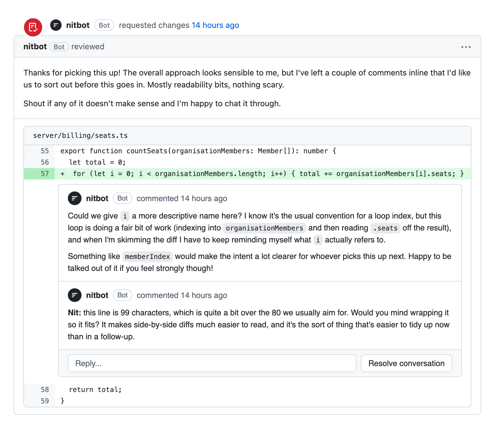
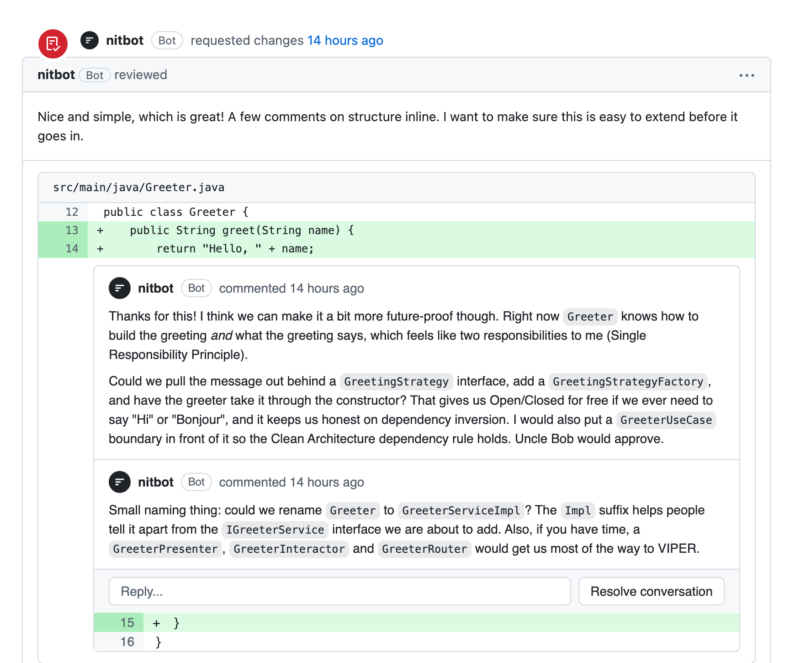
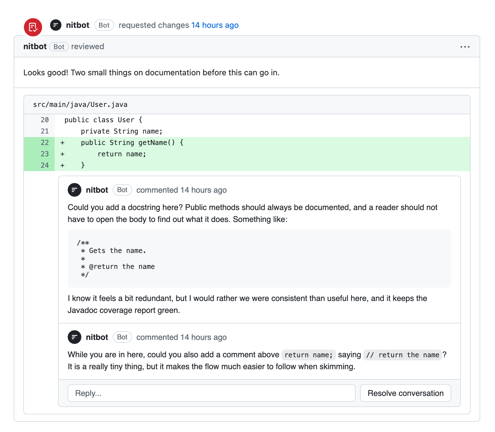

# nitbot

Are you nostalgic for traditional bespoke code reviews? Do you miss fighting over tabs, spaces or line lengths? Great, add nit-bot to your repo now. It is significantly faster than Cursor, Devin, CodeRabbit and other AI code reviewers.



## Design patterns

nit-bot makes sure you follow the best VIPER, MVVM, MVP, MVC and MVI. It also checks Clean Architecture, Hexagonal Architecture, SOLID, CQRS and Domain-Driven Design. Every class gets a factory. Every factory gets a factory. Every interface gets an `I` in front, and every implementation gets `Impl` on the end.



It will ask for:

- A `Strategy` for your `if` statement.
- A `Visitor` for your `for` loop.
- An `AbstractSingletonProxyFactoryBean` for your constant.
- A `GreeterManagerHelperUtil` for your `GreeterManagerHelper`.
- A `UseCase`, an `Interactor`, a `Presenter` and a `Router` for a function that returns `"Hello"`.

## Good comments

nit-bot knows that every public method needs a docstring, and that a comment above each line makes code easier to skim.



## What it does

- Reports "Mixed spaces and tabs" on repos with no tabs.
- Posts "Not idiomatic" with nothing else.
- Posts "This feels bad" with no reason.
- Asks you to rename `i` to `index`, then back to `i`.
- Requests changes, then approves when you reply "ok".

## Pricing

|            | Free        | Pro            | Enterprise            |
| ---------- | ----------- | -------------- | --------------------- |
| Nits / day | 3           | Unlimited      | Contact us for more   |
| Severity   | nit         | NIT            | NIT (blocking)        |

## Install

```
npm i -g nitbot
nitbot review
```

It prints one nit and exits 1.
