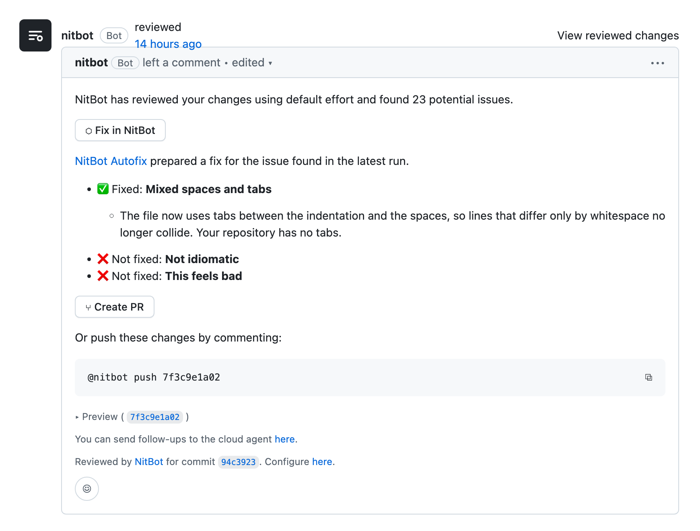
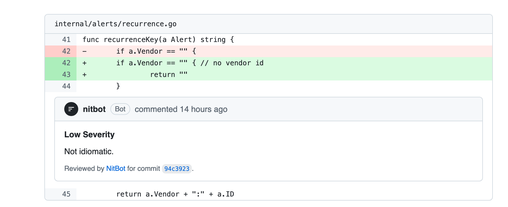
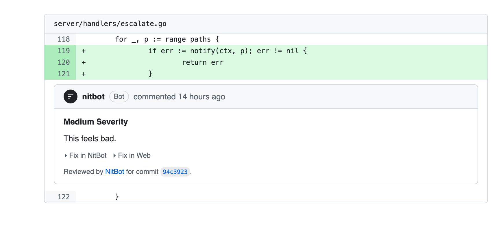

# nitbot

Code review from before we had formatters.







## What it does

- Reports "Mixed spaces and tabs" on repos with no tabs.
- Posts "Not idiomatic" with nothing else.
- Posts "This feels bad" with no reason.
- Asks you to rename `i` to `index`, then back to `i`.
- Requests changes, then approves when you reply "ok".

## Pricing

|            | Free        | Pro            | Enterprise            |
| ---------- | ----------- | -------------- | --------------------- |
| Nits / day | 3           | Unlimited      | Contact us for more   |
| Severity   | nit         | NIT            | NIT (blocking)        |

## Install

```
npm i -g nitbot
nitbot review
```

It prints one nit and exits 1.
